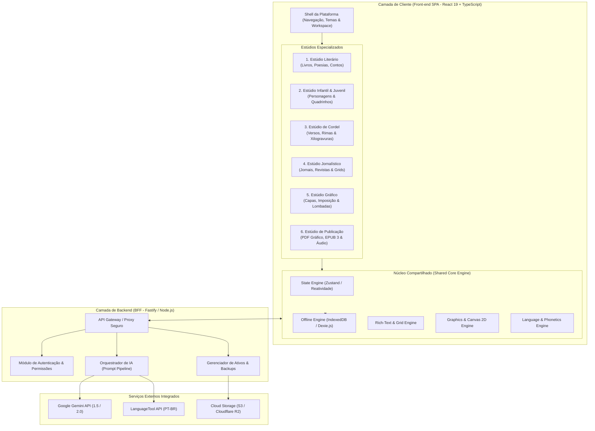

# ARQUITETURA GERAL DA PLATAFORMA
## MEU LIVRO EM INSTANTE — FASE 2: ESPECIFICAÇÃO TÉCNICA DEFINITIVA

**Versão da Arquitetura:** 2.0.0-PROD  
**Data:** 17 de Novembro de 2026  
**Status:** Proposta de Arquitetura para Homologação  
**Base do Projeto:** Evolução modular do protótipo *MEU LIVRO EDITADO* para ecossistema *React 19 + TypeScript + Vite + IndexedDB + BFF Node/Fastify*.

---

## 1. VISÃO GERAL E PRINCÍPIOS ARQUITETÔNICOS

O **MEU LIVRO EM INSTANTE** é uma plataforma editorial integrada projetada para democratizar e profissionalizar o ciclo de vida completo de publicações (criação, ilustração, revisão, diagramação gráfica e distribuição multiplataforma).

### Princípios Norteadores:
1. **Preservação de Ativos e Lógicas Existentes:** As lógicas consolidadas de contagem métrica de cordel, xilogravura digital em Canvas, integração LanguageTool e IA são preservadas e encapsuladas como serviços/módulos puros.
2. **Separação por Estúdios Especializados:** Cada nicho editorial (Literário, Cordel, Infantil/Juvenil, Jornalístico, Gráfico e Publicação) opera em um ambiente adaptado às suas convenções de escrita e diagramação.
3. **Arquitetura Híbrida Offline-First com Sincronização:** O usuário nunca perde seu trabalho. A persistência primária ocorre localmente no navegador via **IndexedDB** (com capacidade de centenas de MBs para mídia) e sincronização com backend quando online.
4. **Segurança de Credenciais e Isolamento de IA:** Chamadas a modelos de inteligência artificial (Gemini, Claude, OpenAI) são intermediadas por um BFF (*Backend-for-Frontend*) seguro, blindando chaves de API e aplicando *rate limiting* e *caching* de contexto.
5. **Fidelidade Gráfica e Editorial:** Adoção do padrão CSS Paged Media (`Paged.js`) e motores dedicados de geração de PDF vetorial e EPUB 3 em estrita conformidade com os padrões W3C/IDPF e gráficas industriais (PDF/X-1a).

---

## 2. DIAGRAMA DA ARQUITETURA GERAL

---

## 3. OS 6 ESTÚDIOS PRINCIPAIS

### 3.1. Estúdio Literário
* **Público & Foco:** Livros tradicionais, romances, antologias poéticas, biografias, ensaios e crônicas.
* **Componentes:**
  * Editor com foco de escrita limpa (*Zen Mode*).
  * Gestor de capítulos com reordenação *drag-and-drop*.
  * Controle de notas de rodapé, referências bibliográficas e epígrafes.
  * Estatísticas em tempo real (tempo estimado de leitura, contagem de palavras e legibilidade Flesch-Kincaid adaptada ao português).

### 3.2. Estúdio Infantil e Juvenil
* **Público & Foco:** Livros ilustrados (*picture books*), fábulas infantis, literatura Young Adult (YA) e tirinhas/quadrinhos.
* **Componentes:**
  * **Criador de Personagens:** Fichas de arquétipos com características visuais, personalidade, arcos dramáticos e consistência narrativa.
  * **Compositor Visual Páginas Duplas:** Modo de visualização *spread* (página esquerda + página direita integradas).
  * **Motor de Roteiro Juvenil:** Sugestão de arcos narrativos com ritmo de suspense/conflito para leitores adolescentes.

### 3.3. Estúdio de Cordel
* **Público & Foco:** Folhetos de cordel, cantorias, métricas nordestinas e livretos tradicionais.
* **Componentes:**
  * **Verificador Métrico e Rimas:** Análise de versos tradicionais (quadras, sextilhas, septilhas, oitavas e décimas) com checagem de rimas (ABCBDB, ABABCC, etc.).
  * **Estúdio de Xilogravura Digital 2.0:** Filtros aprimorados de talhe, xilogravura policromática (2 ou 3 cores tradicionais), ferramentas de goiva virtual e exportação de carimbos em alta definição.
  * **Formatador de Folheto:** Paginação canônica de cordel (múltiplos de 4 ou 8 páginas em tamanho 10,5 × 15 cm ou 13,5 × 18 cm).

### 3.4. Estúdio Jornalístico
* **Público & Foco:** Revistas periódicas, jornais de bairro, tabloides, zines e informativos corporativos.
* **Componentes:**
  * **Grid Multicolunar Dinâmico:** Colunagem profissional (2, 3 ou 4 colunas com calha/gutter personalizável).
  * **Elementos Jornalísticos:** Suporte nativo a manchetes, chapéus, linhas-finas (*lead*), olho de texto (*pull-quotes*), boxes laterais e legendas vinculadas a fotografias.
  * **Controle de Escoamento de Texto (*Text Flow*):** Transbordamento automático de matérias entre colunas e páginas adjacentes.

### 3.5. Estúdio Gráfico
* **Público & Foco:** Criação de capas completas, diagramação estrutural e preparação gráfica para pré-impressão.
* **Componentes:**
  * **Calculador Automático de Lombada/Dorso:** Fórmula matemática baseada na quantidade exata de páginas e gramatura do papel (ex.: Pólen Bold 90g: $\text{páginas} \times 0.0075\text{ cm}$).
  * **Compositor de Capa Tripla:** Capa frontal, lombada com vinco e contracapa com gerador automático de código de barras ISBN (EAN-13 vetorial).
  * **Controle de Sangria e Imposição:** Definição de margens de sangria (3 a 5 mm), área de segurança e visualização de imposição de caderno para encadernação (costura e dobra).

### 3.6. Estúdio de Publicação
* **Público & Foco:** Distribuição, exportação multiformato e acessibilidade.
* **Componentes:**
  * **Exportador PDF/X Gráfico:** Geração de PDF vetorizado, marcas de corte e registro, fontes TrueType/OpenType incorporadas.
  * **Exportador EPUB 3 Validador:** Estrutura empacotada com manifestos `content.opf`, `toc.xhtml`, `toc.ncx`, marcação semântica e suporte a e-readers Kindle/Kobo/Apple Books.
  * **Módulo Audiolivro:** Narração em áudio estruturada com separação por faixas de capítulo e suporte a vozes neurais de alta naturalidade.

---

## 4. COMUNICAÇÃO ENTRE MÓDULOS (EVENT BUS & STATE)

A comunicação entre os estúdios e o núcleo do sistema adota um padrão de arquitetura desacoplada:

1. **Estado Central Reativo (Zustand):** Um repositório de dados de sessão e de projeto ativo com ações imutáveis.
2. **Barramento de Eventos Interno (*Internal Event Bus*):** Eventos como `DOCUMENT_SAVED`, `CHAPTER_UPDATED`, `MEDIA_ATTACHED` e `PAGE_OVERFLOW_DETECTED` disparam ações assíncronas de paginação e persistência sem acoplamento direto entre as telas.
3. **Persistência Reativa (IndexedDB):** Toda alteração despachada no estado é persistida assincronamente através de um *worker* em segundo plano, impedindo qualquer travamento na interface de digitação do autor.

---

## 5. ESTRUTURA DE BANCO DE DADOS E PERSISTÊNCIA

### 5.1. Armazenamento Local Primário (IndexedDB / Dexie)
* **Tabela `projects`:** Metadados do projeto (id, título, subtítulo, autor, estúdio ativo, dimensões de página, configurações de margem, data de criação e versão do esquema).
* **Tabela `chapters`:** Conteúdo dos capítulos/seções com árvore hierárquica, ordem de leitura e metadados específicos de estilo.
* **Tabela `characters`:** Registro de personagens criados (nome, traços, biografia, relacionamentos e imagens anexadas).
* **Tabela `assets`:** Repositório local de binários (capas, fotos, xilogravuras, ilustrações em Blob/ArrayBuffer).
* **Tabela `revisions`:** Histórico de versões locais (Snapshots periódicos com suporte a reversão).

### 5.2. Persistência em Nuvem (PostgreSQL / SQLite via Fastify)
Para sincronização de usuários autenticados:
* Esquema relacional espelhado com suporte a sincronização diferencial baseada em carimbos de tempo (`last_modified_at`) e tratamento de conflitos com resolução *last-write-wins* com preservação de branch de conflito.

---

## 6. AUTENTICAÇÃO E PERMISSÕES

* **Nível 1 - Modo Convidado / Anônimo (Zero Barreiras):** Operação total em modo local (offline-first). Todos os estúdios funcionam sem exigência imediata de login, com dados salvos no dispositivo local.
* **Nível 2 - Usuário Registrado (Sync Nuvem & IA Avançada):**
  * Autenticação via JWT / OAuth2 (Google / E-mail com Magic Link).
  * Chaves e cotas de IA centralizadas e gerenciadas por plano ou uso.
* **Nível 3 - Papéis e Permissões:**
  * `AUTOR`: Escrita de manuscritos, uso de assistentes de IA, geração de capítulos.
  * `ILUSTRADOR`: Acesso específico a capas, matrizes de xilogravura e galeria de personagens.
  * `DIAGRAMADOR`: Edição avançada de folhas-mestras, imposição, sangrias e folhas de estilo.
  * `REVISOR`: Inserção de anotações e aprovação de mudanças ortográficas/estilísticas sem alterar o manuscrito original.

---

## 7. INTEGRAÇÃO COM SERVIÇOS DE IA

* **Proxy de IA Seguro:** O front-end envia apenas o identificador da tarefa e o fragmento de contexto (`prompt payload`). O backend orquestra a chamada com as chaves privadas mantidas em variáveis de ambiente `.env`.
* **Provedores Suportados:**
  * **Google Gemini (Padrão):** Raciocínio editorial longo, geração de cordel rimado, adequação léxica e criação de personagens infantis/juvenis.
  * **Claude / GPT-4o (Pluggable):** Análise estilística aprofundada e revisão de coerência narrativa de longo alcance.
* **Pipeline de Contexto Editorial:**
  * *Prompt Injection Control:* Sanitização de inputs para manter fidelidade às diretrizes de estilo do estúdio selecionado.
  * *Streaming via SSE (Server-Sent Events):* Respostas de IA renderizadas em tempo real caractere a caractere, evitando telas congeladas.

---

## 8. TRATAMENTO DE ERROS, TELEMETRIA E LOGS

1. **Tratamento de Exceções de Cota:** Monitoramento contínuo da cota de armazenamento via `navigator.storage.estimate()`. Caso a memória atinja 80%, alertas visuais orientam o usuário a compactar ou sincronizar seus ativos.
2. **Error Boundaries no React 19:** Falhas em plugins de terceiros ou em visualizadores específicos não derrubam o editor ativo; o usuário mantém o manuscrito intacto.
3. **Registro Local de Auditoria:** Cada ação crítica (exclusão de projeto, exportação, sincronização) é registrada em log de auditoria no IndexedDB para diagnóstico em suporte técnico.

---

## 9. MATRIZ DE JUSTIFICATIVA TÉCNICA (NÃO-SUBSTITUIÇÃO DESNECESSÁRIA)

Conforme a diretriz de **evitar substituições sem justificativa técnica**:
* **Canvas 2D mantido:** A lógica de xilogravura digital desenvolvida no protótipo é preservada em sua totalidade, ganhando apenas camada de aceleração via WebGL para processamento de imagens 4K.
* **LanguageTool mantido:** A integração comprovada com o dicionário e regras gramaticais do português brasileiro permanece como o motor nativo de revisão ortográfica.
* **Métricas de Cordel mantidas:** O algoritmo de verificação silábica e esquemas estróficos (quadra, sextilha, septilha) do protótipo é mantido integralmente e isolado como micro-biblioteca de alta performance.
* **Migração Justificada de `localStorage` para `IndexedDB`:** O limite de 5MB do `localStorage` é incompatível com livros com ilustrações e capas; a adoção do IndexedDB resolve definitivamente o risco de perda de manuscritos.

