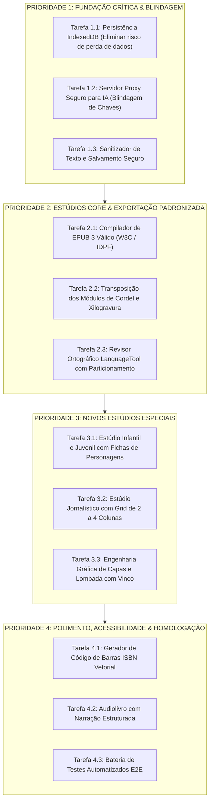

# CRONOGRAMA DE PROGRAMAÇÃO E IMPLEMENTAÇÃO POR PRIORIDADE
## PLATAFORMA: MEU LIVRO EM INSTANTE

**Data de Emissão:** 17 de Novembro de 2026  
**Objetivo:** Roteiro sequencial de desenvolvimento e programação técnica estruturado por ordem estrita de prioridade, garantindo que a base de dados e segurança sejam consolidadas antes das novas interfaces.

---

## 1. VISÃO GERAL DAS FASES E PRIORIDADES

---

## 2. DETALHAMENTO DAS ETAPAS DE PROGRAMAÇÃO

---

### ETAPA 1: PRIORIDADE CRÍTICA — SEGURANÇA E BANCO DE DADOS
*Foco: Proteger o trabalho do autor contra perda de dados e blindar chaves de inteligência artificial.*

#### Tarefa 1.1: Implementação da Persistência em IndexedDB (`Dexie.js`)
* **Justificativa:** O `localStorage` atual estoura ao inserir ilustrações (limite de 5 MB).
* **Atividades de Programação:**
  1. Instalar `dexie` no projeto React.
  2. Implementar classe `MeuLivroDatabase` com tabelas tipadas: `projects`, `chapters`, `characters`, `assets` e `revisions`.
  3. Criar repositório `ProjectRepository` com métodos assíncronos (`saveProject`, `getProjectById`, `listProjects`, `deleteProject`).
  4. Migrar os dados existentes do `localStorage` para o `IndexedDB` automaticamente no primeiro acesso.
* **Critério de Conclusão:** Salvar um livro com 30 ilustrações em alta resolução sem nenhum erro de cota.

#### Tarefa 1.2: Criação do Servidor Proxy Backend Seguro (BFF)
* **Justificativa:** Chaves de API do Google Gemini não podem ficar expostas no código do navegador.
* **Atividades de Programação:**
  1. Configurar servidor leve em Node.js com Fastify na pasta `server/`.
  2. Criar rota `/api/ai/editorial-assist` recebendo tipo de estúdio, tarefa e contexto.
  3. Ler chaves de API exclusivamente de variáveis de ambiente (`.env`).
  4. Configurar streaming de resposta via SSE (*Server-Sent Events*).
* **Critério de Conclusão:** Resposta da IA fluindo caractere a caractere no editor sem expor nenhuma chave no console do navegador.

---

### ETAPA 2: PRIORIDADE ALTA — FORMATO DIGITAL E ESTÚDIOS PRINCIPAIS
*Foco: Padronização internacional de e-books e consolidação dos maiores diferenciais da plataforma.*

#### Tarefa 2.1: Motor de Compilação de EPUB 3.2 Válido
* **Justificativa:** O formato atual gera arquivos `.html` não reconhecidos pelo Kindle e Apple Books.
* **Atividades de Programação:**
  1. Criar empacotador de arquivos ZIP com `jszip`.
  2. Montar arquivo descompactado inicial `mimetype` (`application/epub+zip`).
  3. Gerar arquivos obrigatórios `META-INF/container.xml`, `content.opf` e `toc.xhtml`.
  4. Gerar capítulos em páginas XHTML semânticas com estilos CSS embutidos.
* **Critério de Conclusão:** Arquivo gerado aprovado com nota 100% pelo validador oficial `epubcheck` da W3C.

#### Tarefa 2.2: Migração e Blindagem do Estúdio de Cordel e Xilogravura
* **Atividades de Programação:**
  1. Encapsular a função de escansão de 7 sílabas poéticas no módulo `@core/cordel/metrics.ts`.
  2. Encapsular o manipulador Canvas 2D de xilogravura no componente `@studios/cordel/WoodcutStudio.tsx`.
  3. Adicionar controle de ajuste de espessura de traço e suporte a texturas policromáticas (2 tintas).
* **Critério de Conclusão:** Autor digita sextilhas e o sistema sinaliza versos fora da métrica e rimas com precisão imediata.

#### Tarefa 2.3: Otimizador do Revisor LanguageTool
* **Atividades de Programação:**
  1. Criar componente `GrammarInspector.tsx` desacoplado.
  2. Implementar particionador automático de texto em lotes de 5.000 caracteres.
  3. Aplicar substituições de palavras com preservação das tags HTML adjacentes.
* **Critério de Conclusão:** Revisão ortográfica instantânea sem erro de *429 Too Many Requests*.

---

### ETAPA 3: PRIORIDADE MÉDIA — NOVOS ESTÚDIOS E DESIGN GRÁFICO
*Foco: Expandir a plataforma para o público infantojuvenil, jornais e gráficas industriais.*

#### Tarefa 3.1: Estúdio Infantil e Juvenil com Fichas de Personagens
* **Atividades de Programação:**
  1. Criar tela de cadastro de personagens (`CharacterDrawer.tsx`): nome, idade, traços visuais, psicologia e avatar.
  2. Criar modo de visualização em páginas duplas (*spread view* de 21 × 21 cm).
  3. Conectar a ficha de personagem ao gerador de prompts para ilustrações coerentes.
* **Critério de Conclusão:** O autor consegue criar e associar personagens a capítulos de livros ilustrados.

#### Tarefa 3.2: Estúdio Jornalístico com Grid Multicolunar
* **Atividades de Programação:**
  1. Implementar componente de colunas dinâmicas (2, 3 e 4 colunas) com CSS Grid/Columns.
  2. Criar blocos editoriais prontos: Manchete, Chapéu, Linha-Fina, Olho de Texto, Box de Destaque e Foto-Legenda.
  3. Implementar controle de quebra de matéria (*text flow*).
* **Critério de Conclusão:** Montagem de jornal ou revista em página A4 com manchete e notícias distribuídas em colunas.

#### Tarefa 3.3: Engenharia de Capas Abertas e Cálculo de Lombada
* **Atividades de Programação:**
  1. Desenvolver o compositor de capa aberta (Quarta capa + Lombada com vinco + Primeira capa).
  2. Implementar a fórmula matemática de espessura da lombada baseada na gramatura do papel escolhido.
  3. Adicionar guias visuais de sangria (3 mm a 5 mm) e marcas de corte.
* **Critério de Conclusão:** Exportação de capa aberta em PDF de alta definição pronta para envio a gráfica física.

---

### ETAPA 4: PRIORIDADE BAIXA — REFINAMENTOS FINAIS E DISTRIBUIÇÃO
*Foco: Recursos complementares de acabamento e acessibilidade.*

#### Tarefa 4.1: Gerador de Código de Barras ISBN Vetorial
* **Atividades de Programação:**
  1. Implementar gerador SVG do padrão EAN-13 com base no número de registro oficial do livro.
  2. Posicionar o código de barras no quadrante inferior direito da contracapa.
* **Critério de Conclusão:** Código de barras legível por qualquer aplicativo leitor de código de barras.

#### Tarefa 4.2: Audiolivro Estruturado
* **Atividades de Programação:**
  1. Segmentar leitura por capítulos com controle de pausa, velocidade (1x, 1.25x, 1.5x) e tom.
  2. Adicionar opção de download do arquivo em áudio.
* **Critério de Conclusão:** Reprodução e exportação de áudio estável do primeiro ao último capítulo.

---

## 3. RESUMO DO QUADRO DE PRIORIDADES

| Prioridade | Fase | Principais Entregas | Meta Técnica |
|---|:---:|---|---|
| **P1 - Crítica** | Etapa 1 | Banco IndexedDB + Servidor Proxy IA Blindado | Zero perda de dados e 100% segurança de chaves. |
| **P2 - Alta** | Etapa 2 | EPUB 3 W3C + Estúdio Cordel/Xilogravura + Revisor | Conectar a plataforma ao padrão mundial de livros digitais. |
| **P3 - Média** | Etapa 3 | Estúdio Infantil (Personagens) + Jornalístico (Colunas) + Capa Aberta | Habilitar os novos nichos editoriais planejados. |
| **P4 - Baixa** | Etapa 4 | Código de Barras ISBN + Audiolivro + Testes E2E | Acabamento editorial comercial e acessibilidade. |

