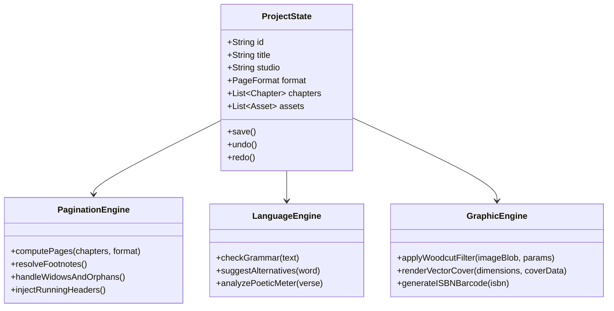

# MAPA DE MÓDULOS E COMPONENTES
## PLATAFORMA: MEU LIVRO EM INSTANTE (FASE 2)

**Documento:** MAPA_DE_MODULOS.md  
**Objetivo:** Mapear a decomposição modular da plataforma, fronteiras de responsabilidade, árvore de diretórios e contratos de interface entre os componentes.

---

## 1. VISÃO HIERÁRQUICA DOS MÓDULOS

A arquitetura organiza-se em 4 grandes camadas funcionais:

```
[MEU LIVRO EM INSTANTE]
 ├── 1. PLATFORM SHELL (Aparência, Navegação, Workspace e Notificações)
 ├── 2. SPECIALIZED STUDIOS (Os 6 Ambientes de Trabalho Editorial)
 │    ├── 2.1. Estúdio Literário
 │    ├── 2.2. Estúdio Infantil e Juvenil
 │    ├── 2.3. Estúdio de Cordel
 │    ├── 2.4. Estúdio Jornalístico
 │    ├── 2.5. Estúdio Gráfico
 │    └── 2.6. Estúdio de Publicação
 ├── 3. SHARED EDITORIAL ENGINES (Motores Centrais Compartilhados)
 │    ├── 3.1. Typography & Rich-Text Engine
 │    ├── 3.2. Pagination & Page-Flow Engine (Paged.js)
 │    ├── 3.3. Woodcut & Graphics 2D Canvas Engine
 │    ├── 3.4. Cordel Metrics & Rhyme Analyzer
 │    ├── 3.5. Grammar & Brazilian Spellchecker (LanguageTool)
 │    └── 3.6. Voice & Audio Generator (Web Speech / Neural TTS)
 └── 4. INFRASTRUCTURE & PERSISTENCE (Infraestrutura e Dados)
      ├── 4.1. Local Storage Engine (IndexedDB com Dexie.js)
      ├── 4.2. Cloud Sync Engine (Sincronização Diferencial)
      ├── 4.3. Secure AI Proxy Client (Comunicação com BFF)
      └── 4.4. Exporter Engine (PDF/X e EPUB 3 Standard)
```

---

## 2. DETALHAMENTO DOS ESTÚDIOS E SEUS COMPONENTES

### 2.1. Estúdio Literário (`@studios/literary`)
* **`LiteraryEditor`:** Área de texto limpa com suporte a modo tela cheia, fontes literárias serifadas (Garamond, Georgia, Caslon, EB Garamond), controle de parágrafos e recuos de primeira linha.
* **`ChapterOrganizer`:** Árvore lateral de capítulos e seções; suporte a arraste e soltura (*drag & drop*) para reestruturar a obra.
* **`FootnoteManager`:** Sistema de notas de rodapé numeradas ou com marcadores, com ancoragem automática no final da página diagramada.
* **`LiteraryStatsBar`:** Métricas de produtividade: total de palavras, contagem de páginas estimadas, tempo médio de leitura e índice de legibilidade.

### 2.2. Estúdio Infantil e Juvenil (`@studios/kids-ya`)
* **`CharacterCreator`:** Criador visual de personagens. Armazena:
  - Ficha biográfica (nome, idade, traços de personalidade, fraquezas, motivações).
  - Galeria de expressões faciais e figurino para consistência nas ilustrações.
  - Gerador de descrições estruturadas para prompts de imagem.
* **`PictureBookCanvas`:** Visualizador de páginas duplas (*spread view*) projetado para proporções infantis (quadrado 21 × 21 cm, paisagem 28 × 21 cm).
* **`StoryArcAssistant`:** Assistente de enredo com templates específicos para contos infantis (apresentação, problema, jornada, resolução) e arcos juvenis/YA (mistério, aventura, conflito de identidade).

### 2.3. Estúdio de Cordel (`@studios/cordel`)
* **`StanzaEditor`:** Editor configurado para composição em versos.
* **`MetricsValidator`:** Motor matemático que audita a métrica poética:
  - Sílabas poéticas (escansão tradicional: redondilha maior / 7 sílabas poéticas).
  - Esquemas de estrofe: Quadras (ABCB), Sextilhas (XAXAXA / ABCBDB), Septilhas (ABCBDBB), Oitavas (ABABCXDD) e Décimas (ABBAACCDDC).
  - Indicador visual em tempo real de verso fora de métrica ou rima imperfeita.
* **`WoodcutStudio`:** Estúdio de xilogravura digital (Canvas 2D):
  - Carregador de fotos reais com conversão instantânea para gravura em madeira.
  - Controles de binarização, textura de sulco, granulação e efeito de talhe manual.
  - Seleção de tintas clássicas (preto nanquim, sépia, ocre, azul colonial).
* **`CordelBookletLayout`:** Imposição automática de folheto para impressão em papel sulfite/kraft dobrado (4, 8, 16 ou 32 páginas).

### 2.4. Estúdio Jornalístico (`@studios/journalism`)
* **`NewspaperGridBuilder`:** Construtor de malhas tipográficas com 2, 3, 4 ou 5 colunas por página.
* **`ArticleFlowEngine`:** Algoritmo que gerencia a quebra e transbordamento contínuo de notícias entre colunas com indicação de "continua na pág. X".
* **`NewsElementsLibrary`:** Blocos padronizados de imprensa:
  - *Manchete e Cartola:* Títulos com hierarquia visual precisa.
  - *Linha-Fina / Subtítulo:* Resumo jornalístico de abertura.
  - *Box / Retranca:* Caixas explicativas com fundo colorido.
  - *Olho de Texto:* Citações destacadas entre as colunas.
  - *Foto-Legenda:* Imagens com créditos de fotógrafo e legenda diagramada.

### 2.5. Estúdio Gráfico (`@studios/graphic`)
* **`CoverDesigner`:** Compositor de capa completa aberta (Contracapa + Lombada + Capa Frontal + Orelhas opcionais).
* **`SpineCalculator`:** Módulo matemático que calcula a largura exata da lombada:
  $$\text{Lombada (mm)} = (\text{Número de Páginas} / 2) \times \text{Espessura da Folha (mm)}$$
  *(com tabela de papéis: Offset 75g, Pólen Soft 80g, Pólen Bold 90g, Couché 115g).*
* **`ISBNBarcodeGenerator`:** Gerador de código de barras vetorial no padrão EAN-13 para registro oficial na CBL / Biblioteca Nacional.
* **`BleedMarksOverlay`:** Grade de visualização com linhas guias:
  - Linha de corte (*Trim line*).
  - Linha de sangria (*Bleed line* — 3 a 5 mm extras).
  - Margem de segurança (*Safe margin* — 5 mm internos livres de textos essenciais).

### 2.6. Estúdio de Publicação (`@studios/publishing`)
* **`PDFPrintExporter`:** Gera arquivo PDF/X-1a ou PDF normal com renderização vetorial das fontes e imagens em 300 DPI.
* **`EPUB3Exporter`:** Gerador de arquivos `.epub` válidos (EPUB 3.2 Reflowable e Fixed Layout) com folha de estilo CSS limpa, divisão correta de capítulos e navegação semântica.
* **`AudiobookGenerator`:** Síntese em áudio do manuscrito através de Web Speech API local ou vozes neurais de backend, com exportação em capítulos de áudio MP3/M4A.

---

## 3. COMPONENTES COMPARTILHADOS (SHARED ENGINES)



---

## 4. ESTRUTURA FÍSICA DE DIRETÓRIOS PROPOSTA

A transição da base de código é estruturada no padrão *Feature-First / Domain-Driven*:

```
meu-livro-em-instante/
├── public/                     # Ativos estáticos e fontes tipográficas
├── src/
│   ├── app/                    # Inicialização da aplicação, rotas e shell
│   │   ├── App.tsx
│   │   ├── Navigation.tsx
│   │   └── TopBar.tsx
│   ├── assets/                 # SVGs, ícones e texturas (papéis, xilogravuras)
│   ├── core/                   # Regras de negócio puras (sem dependência de UI)
│   │   ├── audio/              # Síntese de voz e audiolivro
│   │   ├── cordel/             # Métricas, escansão e rimas (migrado do protótipo)
│   │   ├── graphics/           # Algoritmos Canvas de xilogravura (migrado do protótipo)
│   │   ├── grammar/            # Cliente LanguageTool PT-BR
│   │   ├── ai/                 # Contratos e clientes para os provedores de IA
│   │   ├── pagination/         # Motor de cálculo e layout de páginas
│   │   └── export/             # Motores de compilação PDF e EPUB 3
│   ├── data/                   # Camada de persistência de dados
│   │   ├── db.ts               # Configuração do IndexedDB (Dexie.js)
│   │   ├── repositories/       # Repositórios (ProjectRepository, AssetRepository)
│   │   └── migrations/         # Migrações de schema de dados
│   ├── shared/                 # Componentes de interface compartilhados
│   │   ├── components/         # Botões, Modais, Toolbars, Menus e Inputs
│   │   ├── hooks/              # Hooks customizados (useProject, useAutoSave, useAudio)
│   │   └── ui/                 # Sistema de design (tokens, paletas, variáveis CSS)
│   ├── studios/                # Os 6 Estúdios Especializados
│   │   ├── literary/           # Estúdio Literário
│   │   ├── kids-ya/            # Estúdio Infantil e Juvenil
│   │   ├── cordel/             # Estúdio de Cordel
│   │   ├── journalism/         # Estúdio Jornalístico
│   │   ├── graphic/            # Estúdio Gráfico
│   │   └── publishing/         # Estúdio de Publicação
│   └── main.tsx                # Ponto de entrada React 19
├── server/                     # BFF Seguro (Fastify / Node.js)
│   ├── src/
│   │   ├── routes/             # Endpoints seguros (/api/ai/complete, /api/auth)
│   │   ├── services/           # Chamadas ao Gemini, Claude e LanguageTool
│   │   └── server.ts           # Inicialização do servidor seguro
│   └── package.json
├── package.json
└── tsconfig.json
```

