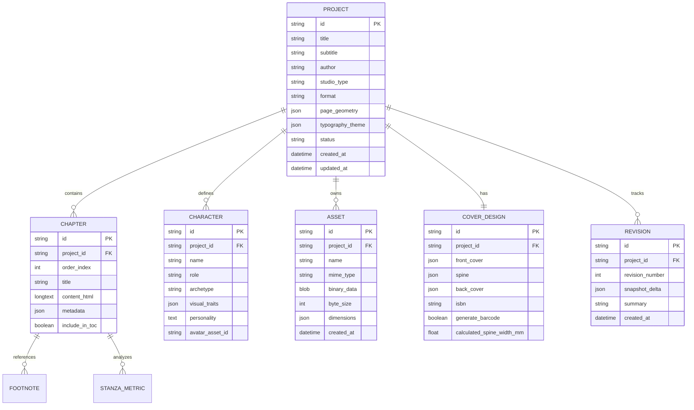

# MODELO DE DADOS E ESQUEMA DE PERSISTÊNCIA
## PLATAFORMA: MEU LIVRO EM INSTANTE (FASE 2)

**Documento:** MODELO_DE_DADOS.md  
**Objetivo:** Definir as estruturas de dados, tipagens estáticas em TypeScript, esquemas de banco de dados local (IndexedDB) e remoto (PostgreSQL/SQLite), e o formato de intercâmbio de projetos.

---

## 1. MODELO CONCEITUAL DE ENTIDADES (ER DIAGRAM)



---

## 2. ESQUEMA TYPESCRIPT COMPLETO (INTERFACES CENTRAIS)

```typescript
/** Identificadores dos 6 Estúdios Especializados */
export type StudioType = 
  | 'literary'      // Romance, Poesia, Conto, Biografia
  | 'kids_ya'       // Histórias Infantis, Juvenis e Quadrinhos
  | 'cordel'        // Literatura de Cordel e Folhetos
  | 'journalism'    // Jornais, Revistas e Boletins
  | 'graphic'       // Capas, Lombadas e Diagramação
  | 'publishing';   // Distribuição e Exportação

/** Formatos Padronizados de Publicação Editorial */
export type PageFormat = 
  | 'a5'            // 148 x 210 mm
  | '14x21'         // Livro Padrão Brasil (140 x 210 mm)
  | '16x23'         // Livro Expandido / Acadêmico (160 x 230 mm)
  | '17x24'         // Livro Técnico (170 x 240 mm)
  | 'a4'            // 210 x 297 mm (Revistas e Jornais Tabloide)
  | 'cordel_padrao' // 105 x 150 mm (Tradicional Nordestino)
  | 'cordel_medio'  // 135 x 180 mm
  | 'custom';       // Dimensões customizadas

/** Configuração Geométrica da Página para Impressão e Tela */
export interface PageGeometry {
  widthMm: number;
  heightMm: number;
  marginTopMm: number;
  marginBottomMm: number;
  marginInsideMm: number;   // Margem interna / canaleta (maior para encadernação)
  marginOutsideMm: number;  // Margem externa
  bleedMm: number;          // Sangria gráfica (padrão 3 a 5 mm)
  columnsCount: number;     // 1 para livros, 2 a 4 para jornais e revistas
  gutterMm: number;         // Espaçamento entre colunas
}

/** Entidade Principal do Projeto */
export interface Project {
  id: string;               // UUID v4
  title: string;
  subtitle?: string;
  author: string;
  coauthors?: string[];
  edition?: string;
  year?: number;
  isbn?: string;
  studioType: StudioType;
  format: PageFormat;
  geometry: PageGeometry;
  typography: {
    fontFamily: string;
    bodyFontSizePt: number;
    lineHeight: number;
    paragraphIndentMm: number;
    hyphenation: boolean;
  };
  chapters: Chapter[];
  characters?: Character[];
  coverDesign?: CoverDesign;
  createdAt: string;        // ISO 8601
  updatedAt: string;        // ISO 8601
  schemaVersion: number;    // v2
}

/** Estrutura do Capítulo ou Artigo */
export interface Chapter {
  id: string;
  projectId: string;
  order: number;
  title: string;
  contentHtml: string;      // Marcação limpa e semântica
  footnotes?: Footnote[];
  newspaperMeta?: {
    kicker?: string;        // Chapéu jornalístico
    lead?: string;          // Linha-fina
    byline?: string;        // Assinatura do repórter
    columnSpan?: number;
  };
  cordelMeta?: {
    stanzaType: 'quadra' | 'sextilha' | 'septilha' | 'oitava' | 'decima';
    rhymeScheme: string;
    verifiedMeter: boolean;
  };
}

/** Estrutura da Ficha de Personagem (Estúdio Infantil e Juvenil) */
export interface Character {
  id: string;
  projectId: string;
  name: string;
  ageGroup: 'infantil' | 'adolescente' | 'adulto';
  role: 'protagonista' | 'antagonista' | 'coadjuvante' | 'mentor';
  visualTraits: {
    hair: string;
    eyes: string;
    clothing: string;
    distinctiveFeatures: string;
  };
  psychologicalTraits: string[];
  backstory: string;
  avatarAssetId?: string;
}

/** Estrutura do Design de Capa (Estúdio Gráfico) */
export interface CoverDesign {
  id: string;
  projectId: string;
  paperType: 'polen_bold_90' | 'polen_soft_80' | 'offset_75' | 'couche_115';
  totalPageCount: number;
  calculatedSpineWidthMm: number;
  frontCover: {
    title: string;
    subtitle?: string;
    author: string;
    backgroundImageAssetId?: string;
    woodcutOverlayAssetId?: string;
    textColor: string;
    bgColor: string;
  };
  spine: {
    text: string;
    direction: 'horizontal' | 'vertical_down';
    showAuthor: boolean;
  };
  backCover: {
    synopsis: string;
    barcodeIsbn?: string;
    publisherLogoAssetId?: string;
    authorBio?: string;
  };
}
```

---

## 3. ESQUEMA DE PERSISTÊNCIA LOCAL (INDEXEDDB COM DEXIE.JS)

O banco de dados local roda no cliente sem limite de 5MB, suportando até centenas de megabytes de imagens de alta resolução:

```typescript
import Dexie, { Table } from 'dexie';

export class MeuLivroDatabase extends Dexie {
  projects!: Table<Project, string>;
  chapters!: Table<Chapter, string>;
  characters!: Table<Character, string>;
  assets!: Table<{ id: string; projectId: string; name: string; mimeType: string; data: Blob; createdAt: string }, string>;
  revisions!: Table<{ id: string; projectId: string; timestamp: string; delta: any }, string>;

  constructor() {
    super('MeuLivroEmInstanteDB');
    this.version(1).stores({
      projects: 'id, title, studioType, updatedAt',
      chapters: 'id, projectId, order',
      characters: 'id, projectId, name',
      assets: 'id, projectId, mimeType',
      revisions: 'id, projectId, timestamp'
    });
  }
}

export const db = new MeuLivroDatabase();
```

---

## 4. ESQUEMA RELACIONAL PARA SINCRONIZAÇÃO EM NUVEM (POSTGRESQL / SQLITE)

```sql
-- Tabela de Usuários
CREATE TABLE users (
    id UUID PRIMARY KEY DEFAULT gen_random_uuid(),
    email VARCHAR(255) UNIQUE NOT NULL,
    full_name VARCHAR(255) NOT NULL,
    role VARCHAR(50) DEFAULT 'author',
    created_at TIMESTAMP WITH TIME ZONE DEFAULT NOW()
);

-- Tabela de Projetos Sincronizados
CREATE TABLE cloud_projects (
    id UUID PRIMARY KEY,
    user_id UUID REFERENCES users(id) ON DELETE CASCADE,
    title VARCHAR(255) NOT NULL,
    studio_type VARCHAR(50) NOT NULL,
    format VARCHAR(50) NOT NULL,
    geometry_json JSONB NOT NULL,
    typography_json JSONB NOT NULL,
    version INT NOT NULL DEFAULT 1,
    is_deleted BOOLEAN DEFAULT FALSE,
    updated_at TIMESTAMP WITH TIME ZONE DEFAULT NOW()
);

-- Tabela de Capítulos
CREATE TABLE cloud_chapters (
    id UUID PRIMARY KEY,
    project_id UUID REFERENCES cloud_projects(id) ON DELETE CASCADE,
    order_index INT NOT NULL,
    title VARCHAR(255) NOT NULL,
    content_html TEXT NOT NULL,
    metadata_json JSONB DEFAULT '{}',
    updated_at TIMESTAMP WITH TIME ZONE DEFAULT NOW()
);

-- Armazenamento de Arquivos/Binários
CREATE TABLE cloud_assets (
    id UUID PRIMARY KEY,
    project_id UUID REFERENCES cloud_projects(id) ON DELETE CASCADE,
    file_key VARCHAR(500) NOT NULL, -- Referência no S3 / R2
    file_name VARCHAR(255) NOT NULL,
    mime_type VARCHAR(100) NOT NULL,
    byte_size INT NOT NULL,
    created_at TIMESTAMP WITH TIME ZONE DEFAULT NOW()
);
```

---

## 5. FORMATO DE PACOTE DE INTERCÂMBIO DE ARQUIVOS (`.meulivro`)

Para permitir que o usuário faça backup, compartilhe ou importe projetos completos entre dispositivos offline:

* **Extensão:** `.meulivro`
* **Especificação Física:** Arquivo ZIP compactado contendo:
  ```
  meu_livro_export.meulivro (ZIP Container)
  ├── manifest.json         # Metadados e versão do schema
  ├── project.json          # Árvore completa do projeto e geometria
  ├── chapters/             # Arquivos HTML semânticos por capítulo
  │   ├── ch_001.html
  │   └── ch_002.html
  ├── characters.json       # Fichas de personagens (quando houver)
  ├── cover.json            # Layout e dados da capa
  └── assets/               # Imagens, xilogravuras e ilustrações em formato nativo
      ├── cover_bg.png
      └── woodcut_01.png
  ```

