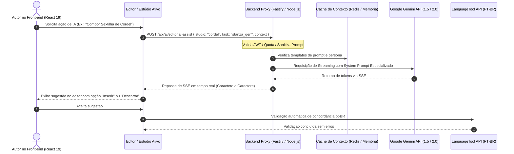

# PLANO DE INTEGRAÇÃO COM SERVIÇOS DE INTELIGÊNCIA ARTIFICIAL
## PLATAFORMA: MEU LIVRO EM INSTANTE (FASE 2)

**Documento:** PLANO_DE_INTEGRACAO_IA.md  
**Objetivo:** Estabelecer a arquitetura técnica, pipeline de prompts especializados por estúdio, blindagem de credenciais e gestão de contexto dos assistentes de Inteligência Artificial.

---

## 1. VISÃO GERAL E PILARES DO SUBSISTEMA DE IA

O subsistema de Inteligência Artificial do **MEU LIVRO EM INSTANTE** foi concebido não como um substituto da criatividade do autor, mas como um **copiloto editorial inteligente**. 

### Pilares Fundamentais:
1. **Segurança de Chaves e Isolamento (BFF Seguro):** Nenhuma chave de API permanece no navegador do cliente em ambiente de produção; todas as chamadas transitam por um proxy backend autenticado.
2. **Especialização por Estúdio:** Os prompts deixam de ser comandos genéricos ("continue o texto") e passam a ser orquestrados com personas editoriais rígidas (Mestre de Cordel, Roteirista Infantil, Editor Jornalístico, Crítico Literário).
3. **Respostas em Streaming (SSE):** Geração contínua de texto em tempo real caractere a caractere, permitindo interrupção a qualquer instante pelo usuário.
4. **Respeito ao Estilo e Voz do Autor:** Injeção de amostras dos capítulos anteriores do projeto no contexto para preservação de tom, vocabulário e ritmo narrativo.

---

## 2. ARQUITETURA DO PROXY DE IA (BACKEND-FOR-FRONTEND)



---

## 3. PIPELINES DE PROMPTS ESPECIALIZADOS POR ESTÚDIO

### 3.1. Estúdio de Cordel — O "Mestre Poeta de Bancada"
* **Objetivo:** Produzir ou sugerir versos que atendam estritamente à métrica poética popular e à tradição lírica nordestina.
* **System Prompt Base:**
  ```text
  Você é um mestre cordelista tradicional do Nordeste brasileiro.
  REGRAS INVIOLÁVEIS:
  1. Escreva estritamente em estrofes de SEXTILHA (6 versos) ou SEPTILHA (7 versos), conforme solicitado.
  2. Toda linha DEVE ter 7 sílabas poéticas (redondilha maior), escandidas pela convenção da poesia popular (com elisão vocálica).
  3. No caso de sextilha, as rimas OBRIGATÓRIAS ocorrem nos versos pares: 2, 4 e 6 (esquema ABCBDB). Os versos 1, 3 e 5 são soltos.
  4. Use vocabulário rico, imagético e autêntico da cultura popular, sem anacronismos ou gírias descontextualizadas.
  ```

### 3.2. Estúdio Literário — O "Consultor de Estilo e Narrativa"
* **Objetivo:** Desbloquear o autor, sugerir variações de diálogo, aprofundar descrições sensoriais e manter a coerência psicológica dos personagens.
* **Tarefas Especializadas:**
  * `expand_scene`: Enriquece o cenário com detalhes sensoriais (aromas, iluminação, textura, sons).
  * `tighten_prose`: Remove redundâncias, advérbios em "-mente" excessivos e prolixidade mantendo a mensagem central.
  * `dialogue_polish`: Diferencia a cadência da fala entre interlocutores.

### 3.3. Estúdio Infantil e Juvenil — O "Contador de Fábulas e Roteirista YA"
* **Objetivo:** Adequar a linguagem e complexidade cognitiva à faixa etária do leitor e manter coerência com as fichas de personagens.
* **Parametrização:**
  * **Primeira Infância (0-5 anos):** Frases curtas, ritmo musical, repetições lúdicas, foco em cores e animais.
  * **Infantojuvenil (6-11 anos):** Narrativa com desafios morais leves, empatia, humor e vocabulário pedagógico.
  * **Young Adult (12-17 anos):** Conflitos de identidade, ritmo ágil, diálogos dinâmicos e desenvolvimento de suspense/ação.
  * **Gerador de Prompts de Ilustração:** Converte a cena escrita em prompt descritivo para geradores de imagem (ex.: *"Ilustração infantil digital em aquarela suave mostrando [Personagem X] com seu casaco amarelo..."*).

### 3.4. Estúdio Jornalístico — O "Editor-Chefe e Redator Sênior"
* **Objetivo:** Estruturação no modelo clássico de jornalismo de qualidade.
* **Tarefas Especializadas:**
  * `generate_lead`: Sintetiza a matéria respondendo às 6 perguntas fundamentais (*O quê, Quem, Onde, Quando, Como, Por quê*).
  * `headline_variants`: Sugere 5 alternativas de manchetes (informativa, opinativa, apelativa para capa e analítica).
  * `pull_quote_extractor`: Identifica as 3 frases de maior impacto na matéria para diagramação em olho de texto.

### 3.5. Estúdio Gráfico e Publicação — O "Copidesque e Redator de Quarta Capa"
* **Objetivo:** Geração de elementos paratextuais comerciais:
  * Sinopse atraente para o leitor de livraria.
  * Texto de orelha apresentando o autor com autoridade.
  * Resumo executivo para catalogação editorial.

---

## 4. GESTÃO DE CONTEXTO E MEMÓRIA DE LONGO ALCANCE

Para obras com múltiplos capítulos (100 a 400 páginas), o envio de todo o manuscrito ultrapassa cotas e eleva custos. A arquitetura adota a técnica **Hierarchical Context Compression**:

1. **Memória de Projeto (*Project Bible*):** Um objeto JSON compacto contendo:
   - Premissa da obra (máximo 100 palavras).
   - Lista resumida de personagens principais e seus relacionamentos.
   - Resumo sequencial dos capítulos anteriores (1 parágrafo por capítulo).
2. **Contexto Ativo Local:**
   - Últimos 2 parágrafos do capítulo imediatamente anterior (para transições suaves).
   - O capítulo ativo em edição.
3. **Total de Tokens Otimizado:** A requisição média consome menos de 1.500 tokens de entrada, permitindo respostas ultrarrápidas com latência inferior a 800 ms.

---

## 5. REGRAS DE PRIVACIDADE E CONTROLE DO AUTOR

* **Armazenamento de Histórico:** O usuário pode ativar ou desativar o registro local de conversas com a IA.
* **Não-treinamento:** As chamadas através de contas corporativas ou chaves pagas utilizam parâmetros de exclusão de dados de treino (`data_retention: false`), preservando os direitos autorais e inéditos das obras.
* **Marcador de Transparência:** Projetos com trechos gerados integralmente por IA possuem metadados de procedência nos termos das diretrizes éticas contemporâneas de publicação digital.

